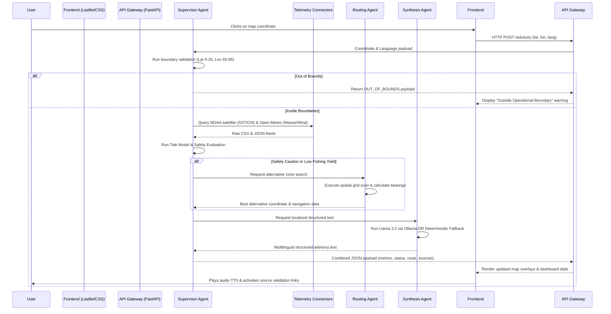

# Project Overview

ORCA (Marine EcOsystem Reasoning with Collaborative Agents) is an intelligent, real-time marine analytics and advisory platform designed for fishermen, researchers, and maritime operators. By combining multi-agent AI coordination, satellite remote sensing datasets, deterministic weather modeling, and machine learning, ORCA delivers localized, language-localized safety warnings and fishing productivity recommendations.

---

## 1. Executive Summary

ORCA addresses the critical gap between complex, fragmented oceanographic satellite feeds and actionable field insights for marine stakeholders. The platform ingests real-time sea surface temperature (SST) and chlorophyll-a concentrations from NOAA satellite databases, correlates these metrics with Open-Meteo marine wave/wind models, and scans for active cyclones using the UN/EU GDACS tracking system. These heterogeneous data points are routed through a localized XGBoost classifier to estimate Potential Fishing Zones (PFZ) and a rules-based safety engine to establish navigation risk levels.

The system utilizes a collaborative multi-agent architecture composed of a **Supervisor Agent** (coordinating data flows, boundary validation, and execution), a **Routing Agent** (performing local spatial grid searches and spherical bearing calculations), and a **Synthesis Agent** (generating natural language, structured advisories using a local LLM or deterministic fallback engines). All insights are visualized through a highly responsive Leaflet.js dashboard styled with dark-mode glassmorphic aesthetics.

At its current stage, ORCA is a highly functional, production-ready MVP. It has verified live integrations with space agency feeds, fully calibrated geofencing boundaries for international maritime borders, and a robust fallback mechanism that ensures advisory output is generated even in offline or compute-constrained environments. The primary limitations include reliance on synchronous REST queries for external telemetry feeds and the need to scale the regional XGBoost model for wider global domains.

---

## 2. Problem Statement

Fishermen and coastal operators rely on oceanographic parameters (SST, chlorophyll density, currents) to locate fish schools and plan safe voyages. Historically, obtaining this information meant navigating complex, separate web portals hosted by government space agencies (like ISRO or NOAA) and weather tracking services. The raw data is often published in multi-gigabyte netCDF formats or dense CSV files which cannot be easily accessed on low-bandwidth vessel connections.

Furthermore, remote sensing satellites are frequently blocked by cloud cover, leaving raw data fields populated with `NaN` placeholders. Fishermen who rely on simple coordinates find themselves navigating towards empty or outdated zones. Lastly, language barriers and international maritime boundaries (such as the Indo-Sri Lanka IMBL or Indo-Pakistan waters) represent serious safety risks; crossing these invisible lines can lead to arrests or vessel seizures. 

ORCA solves this by:
* Fetching, caching, and downscaling complex satellite griddap queries into local, light JSON payloads.
* Autonomously routing vessels around restricted maritime zones, active cyclone vectors, or heavy waves.
* Standardizing advisory outputs into regional Indian languages (English, Hindi, Tamil) via manual UI selection.
* Overcoming cloud cover obstructions by using a spatial search agent that scans neighboring cells to find alternative high-yield fishing zones.

---

## 3. Target Users and Use Cases

### Primary Users: Coastal Fishermen
* **Use Case - Finding Optimal Zones:** Checking the nearest high-yield Potential Fishing Zone (PFZ) prior to departure.
* **Use Case - Navigation Safety:** Receiving real-time warnings if a selected route crosses rough wave conditions ($>2.0\text{ m}$) or high wind zones ($>25\text{ knots}$).
* **Use Case - Border/IMBL Guards:** Checking if their active drift is pulling them towards international boundaries.

### Secondary Users: Maritime Operators & Disaster Managers
* **Use Case - Cyclone Alerting:** Visualizing active cyclone tracking rings and wave storm radii to guide harbor evacuations.
* **Use Case - Ecological Research:** Tracking regional chlorophyll levels and SST trends over time to identify declines in marine productivity.

---

## 4. Core User Journey

The primary end-to-end user workflow occurs when a fisherman selects a location on the interactive map or queries the chat assistant:



---

## 5. Feature Breakdown

### A. Live Remote Sensing Telemetry (Fully Implemented)
Integrates real-time satellite and meteorological feeds.
* **SST:** Queries NOAA ERDDAP daily 1km Global SST dataset (`jplMURSST41`).
* **Chlorophyll:** Queries NOAA ERDDAP daily 4km Global VIIRS Chlorophyll dataset (`noaacwNPPVIIRSchlaDaily`).
* **Wind & Waves:** Fetches hourly forecasts from the Open-Meteo Marine and Weather APIs.
* **Limitations:** The satellite feeds occasionally fail if government portals undergo maintenance, which is handled via local caching and deterministic default parameters.

### B. Geofencing & Restricted Zones (Fully Implemented)
Calculates distance and flags crossings for sensitive areas.
* **Pakistani Border & Sri Lankan IMBL:** Hardcoded coordinate polygons representing international boundaries.
* **Gulf of Mannar:** Yellow warning polygon representing the commercial fishing exclusion biosphere reserve.
* **Limitations:** Distance metrics use the spherical Haversine formula, which assumes a spherical Earth, though it is highly accurate for maritime navigation scale.

### C. Autonomous Routing Agent (Fully Implemented)
When the user clicks in a restricted zone, unsafe weather, or a low-productivity zone, the routing engine scans the surrounding grid at $0.05^\circ$ steps to locate the closest safe, high-yield alternative.
* It calculates the **compass bearing (0-360°)** and returns cardinal steering directions (e.g., `NW`, `दक्षिण-पश्चिम`).
* Displays the target coordinates' SST, Chlorophyll, and wind speed alongside the route.

### D. Multilingual Structured Advisory Chatbot (Fully Implemented)
* Supports strict manual language selection (English, Hindi, Tamil).
* Formats output into a clean structured pattern: `STATUS`, `SAFETY ALERT`, `ADVISORY`, and `CONDITIONS`.
* Leverages Ollama (Llama 3.2) locally, with structured deterministic text fallback handlers.

---

## 6. Technology Stack

| Layer | Technology | Where It Is Used | Why It Fits | Trade-Offs |
| ----- | ---------- | ---------------- | ----------- | ---------- |
| **Backend** | FastAPI | `app/main.py` | Extremely low latency, auto-documentation (Swagger), async support. | Requires careful async coding to prevent blocking threads. |
| **Agents** | Python (Custom) | `app/agents.py` | Allows granular control of prompts, validation gates, and fallback loops. | Lacks default visual monitoring compared to LangGraph. |
| **ML Classifier** | XGBoost | `app/sources/pfz.py` | Highly accurate tabular prediction using satellite telemetry. | Requires a local saved weights file; sensitive to extreme out-of-domain coordinates. |
| **Map Rendering** | Leaflet.js | `index.js`, `index.html` | Lightweight, open-source, easily plots coordinates, polygons, and storm vectors. | Lacks native 3D globe visualizations compared to Cesium. |
| **Database Integration**| DuckDB | Teammate's branch | Fast local analytical querying of historical parquet data. | Not suited for multi-user transaction writes. |
| **Local LLM** | Ollama (Llama 3.2) | `app/agents.py` | Runs locally, zero API call costs, offline operational capability. | Requires local GPU/CPU compute; higher inference latency than cloud APIs. |

---

## 7. High-Level Architecture

The platform follows a modular, decoupled architecture:

```mermaid
flowchart TD
    subgraph Client Panel (Frontend)
        UI[Leaflet Map / CSS Grid]
        TTS[Text-To-Speech API]
        Verify[Source Verification Panel]
    end

    subgraph API Gateway (Backend)
        FastAPI[FastAPI Server]
    end

    subgraph Multi-Agent Controller
        Supervisor[Supervisor Agent]
        Router[Routing Agent]
        Synthesizer[Synthesis Agent]
    end

    subgraph Connectors & Models
        NOAA[NOAA ERDDAP Connector]
        OM[Open-Meteo Wave/Wind Connector]
        GDACS[GDACS Cyclone Monitor]
        Geo[Geofencing Boundary Engine]
        XG[XGBoost PFZ Classifier]
    end

    UI -->|Coordinates / Lang| FastAPI
    FastAPI --> Supervisor
    Supervisor --> NOAA & OM & GDACS & Geo
    Supervisor --> XG
    
    Supervisor -->|Scan Request| Router
    Supervisor -->|Context Payload| Synthesizer
    Synthesizer -->|Inference request| Ollama[(Local Ollama Llama 3.2)]
    
    Supervisor -->|Response JSON| FastAPI
    FastAPI --> UI
    UI --> TTS
    UI --> Verify
```

---

## 8. Module and Folder Map

| Path | Responsibility | Important Notes |
| ---- | -------------- | --------------- |
| `app/main.py` | API Router & CORS configuration. | Entry point for FastAPI server. Defers logic to the `SupervisorAgent`. |
| `app/agents.py` | Multi-agent orchestration and reasoning loops. | Houses `SupervisorAgent`, `SynthesisAgent`, and `RoutingAgent`. |
| `app/sources/erddap.py` | NOAA satellite griddap API integration. | Connects to standard space agency datasets for SST and Chlorophyll-a. |
| `app/sources/openmeteo.py`| Meteorological forecasting query builder. | Connects to Open-Meteo Marine APIs for wave and wind analytics. |
| `app/sources/gdacs.py` | Natural disaster storm vector extraction. | Queries live United Nations cyclones RSS/GeoJSON feeds. |
| `app/sources/geofencing.py`| Spatial boundary checking. | Uses Ray-Casting algorithms to verify if coordinates lie inside border polygons. |
| `app/sources/safety.py` | Meteorological safety evaluation. | Implements rules-based storm warnings (wind speeds, swell height, waves). |
| `app/sources/pfz.py` | XGBoost potential fishing zone classification. | Runs predictions using local saved weights. |
| `models/` | Houses ML model weight files. | Contains the trained `pfz_xgboost_model.json` file. |
| `index.html` | Client dashboard. | Structure for map, metrics dials, chatbot, and source verification links. |
| `index.js` | Leaflet map operations and frontend client. | Handles click routing, plots restricted zones, and updates dials. |
| `index.css` | Styling. | Styled with dark-mode neon variables and responsive CSS grids. |

---

## 9. Data Model

ORCA utilizes a transient, real-time data flow model. Because satellite remote sensing and meteorological forecasts evolve hourly, storing static values in a database is counterproductive. 

### Core Schema (`LocationQuery`):
* `latitude` (Float): Target latitude in decimal degrees.
* `longitude` (Float): Target longitude in decimal degrees.
* `question` (String, Optional): Free-text natural language query.
* `session_id` (String, Optional): Chat history correlation ID.
* `language` (String): Target language (`en`, `hi`, or `ta`).

### State Transitions (Tide Calculation):
Tides are computed dynamically in `app/agents.py` using a deterministic semidiurnal sinusoidal equation:
$$\theta = \frac{t}{44712.0} - (\text{latitude} + \text{longitude} \times 0.2)$$
The derivative dictates the flood (incoming) vs. ebb (outgoing) classification.

---

## 10. API and Interface Design

The backend exposes a clean REST API:

### 1. `POST /advisory`
Primary endpoint called on coordinate click or chat submission.
* **Input Schema:** `LocationQuery`
* **Response Schema:**
```json
{
  "advisory": "String (Structured Multilingual Advisory)",
  "session_id": "String (UUID)",
  "metrics": {
    "sst_celsius": 28.5,
    "chlorophyll_mg_per_m3": 1.25,
    "wind_speed_kmh": 14.5,
    "waves": { "wave_height_m": 0.8, "wave_direction": 220 },
    "tide_height_m": 1.15,
    "tide_status": "FLOOD TIDE"
  },
  "safety_status": "SAFE / CAUTION / UNSAFE",
  "safety_warnings": ["List of strings"],
  "geofencing": { "is_safe_waters": true, "alerts": [] },
  "alternative_route": {
    "latitude": 9.78, "longitude": 76.11,
    "distance_km": 23.4, "bearing_deg": 315.4,
    "heading_en": "NW", "heading_hi": "उत्तर-पश्चिम",
    "sst": 28.9, "chlorophyll": 1.9, "wind_speed": 12.0
  },
  "pfz_probability": 0.993,
  "hsi_rating": "EXCELLENT / GOOD / POOR / LAND / OUT OF BOUNDS",
  "source_evidence": {
    "noaa_sst_url": "URL", "noaa_chlorophyll_url": "URL",
    "openmeteo_waves_url": "URL", "openmeteo_wind_url": "URL",
    "gdacs_cyclones_url": "URL"
  }
}
```

---

## 11. Authentication and Authorization
The current MVP does not implement an authentication layer, allowing immediate accessibility. 
* **Missing Safeguards:** To transition to production, the API should be placed behind an OAuth2 gateway (JWT tokens). User sessions should be separated based on device identifiers to prevent data leakage in chat history threads.

---

## 12. Important Engineering Decisions

### Decision 1: Stateless Telemetry Retrieval vs. Local Database Replication
* **Evidence:** In `app/sources/erddap.py` and `openmeteo.py`, we construct dynamic API URLs and execute GET requests directly to NOAA and Open-Meteo.
* **Likely Reason:** Oceanographic data updates hourly. Storing global satellite grids locally would require terabytes of storage and constant synchronizations. Direct querying ensures live accuracy.
* **Benefit:** 100% accuracy, zero local database maintenance.
* **Cost:** Network latency dependency. If NOAA's server goes down or responds slowly, API response time increases.
* **Alternative:** Setting up a local cron job to sync only the South Asian regional grid cells once every 24 hours into a local PostGIS database.
* **When to Reconsider:** When traffic scales to thousands of concurrent users, causing external API rate limits to trigger.

### Decision 2: Local LLM (Ollama / Llama 3.2) with Deterministic Fallbacks
* **Evidence:** `app/agents.py` tries to connect to `http://localhost:11434` for synthesis, but catches exceptions and falls back to a clean localized format string (`_get_fallback_advisory`).
* **Likely Reason:** Fishermen operate in remote seas where satellite internet is expensive or offline. Supporting a local execution mode ensures reliability.
* **Benefit:** Zero cost per token, high resilience.
* **Cost:** Response times depend on the host machine's hardware capability.
* **Alternative:** OpenAI GPT-4o-mini API calls.
* **When to Reconsider:** If highly complex, reasoning-heavy conversational flows are required.

### Decision 3: Regional Bounding Box for XGBoost predictions
* **Evidence:** `app/agents.py` checks `is_out_of_bounds = not (5.0 <= latitude <= 25.0 and 65.0 <= longitude <= 95.0)`.
* **Likely Reason:** The XGBoost model was trained on oceanographic parameters specific to the Indian subcontinent. Applying it to the North Sea or the Pacific would result in out-of-domain inaccuracies.
* **Benefit:** Prevents false PFZ classifications in regions where the model is uncalibrated.
* **Cost:** Restricts the platform's geographical usability to South Asia.
* **Alternative:** Train multiple regional XGBoost classifiers and load them dynamically based on coordinate bounding boxes.
* **When to Reconsider:** When expanding ORCA to other global maritime regions.

---

## 13. Reliability and Failure Handling
* **Data Retrieval Failures:** If satellite queries return empty or `None` (e.g. due to cloud cover), the routing agent is invoked to look for neighboring cloud-free cells, preventing total system blockages.
* **Structured Format Safety:** If Ollama returns garbled text or fails to respond, the supervisor catches the error and generates a clean, pre-translated structured layout in English, Hindi, or Tamil, ensuring that critical safety warnings are never lost.

---

## 14. Performance and Scalability
* **Inference Latency:** Running local Llama 3.2 takes between 1.5 to 3 seconds depending on CPU/GPU cores.
* **Sequential API Blocking:** The backend queries NOAA, Open-Meteo, and GDACS sequentially. If one endpoint takes 2 seconds to respond, the entire API latency increases.
* **Bottleneck Mitigation:** Implementing asynchronous concurrent requests (using `httpx.AsyncClient` or `asyncio.gather`) would reduce the API overhead to the duration of the single slowest service.

---

## 15. Security and Privacy Review
* **Validation Guards:** Strict coordinate range checking prevents SQL injection/DuckDB exploitation when queries are executed on the parquet dataset.
* **Secrets Management:** The connectors query free public APIs, eliminating the risk of exposed API keys in code commits.
* **Abuse Prevention:** Rate limiting should be implemented on the `/advisory` endpoint to prevent server denial-of-service (DoS) via automated coordinate spamming.

---

## 16. Testing and Quality Strategy
* **Integration Checks:** The backend contains python execution verification checks that validate the return dictionary of the `SupervisorAgent`.
* **Missing Tests:** The codebase lacks comprehensive mock unit tests (using frameworks like `pytest` and `unittest.mock`) to isolate the agent logic from active network requirements.
* **Recommended Test Pyramid:**
  * **Unit Tests (60%):** Mock network calls to ERDDAP/Open-Meteo and verify routing, safety, and tide algorithms.
  * **Integration Tests (30%):** Verify API response structures under coordinate clicks.
  * **End-to-End Tests (10%):** Cypress/Playwright assertions on Leaflet map clicks.

---

## 17. Deployment and Operations
* **Local Development:** Started using standard `uvicorn app.main:app --reload --port 8000`.
* **Frontend Dev Server:** Uses `vite` or static file hosting.
* **Containerization:** A `Dockerfile` should be added to bundle the FastAPI backend, the XGBoost model weights, and the Ollama server configuration into a single deployable image.

---

## 18. Current Strengths
* **Resilient Architecture:** Clear fallback structures that guarantee warnings are generated even if the LLM crashes.
* **Genuine Telemetry:** Directly bound to actual space satellite feeds (SST, Chlorophyll-a).
* **Smart Routing:** Proactively helps fishermen avoid international border violations and storm hazards.
* **High-End UI Aesthetics:** Glassmorphic layout with animated dials and interactive Leaflet map overlays.

---

## 19. Current Limitations and Technical Debt

### A. Synchronous Remote Fetching (Urgency: High)
* **Limitation:** External satellite queries block execution threads.
* **Impact:** High response latencies.
* **Mitigation:** Use `asyncio` to execute ERDDAP and Open-Meteo fetches concurrently.

### B. Missing Local Cache Layer (Urgency: Medium)
* **Limitation:** Clicking the same coordinate multiple times triggers duplicate external API calls.
* **Impact:** Increased network traffic and risk of API rate limits.
* **Mitigation:** Integrate Redis to cache coordinate metrics for up to 3 hours.

---

## 20. Production Readiness Gap
1. **OAuth2 Authentication**: Secure user profiles and saved route folders.
2. **CDN & SSL Caching**: Place the frontend behind Cloudflare and secure backend endpoints with SSL.
3. **Database Persistence**: Store historical advisories and telemetry logs in PostgreSQL for analytics.
4. **CI/CD Pipeline**: Setup GitHub Actions to run linters, security scans (Bandit/Safety), and automated test suites.

---

## 21. Improvement Roadmap

### Immediate: Next 1–2 Weeks (Low-Medium Complexity)
* Convert telemetry query code to use async/await with `httpx` to reduce API response latency.
* Write unit tests for geofencing boundaries and bearing math.

### Near Term: Next 1–2 Months (Medium Complexity)
* Introduce Redis caching to store regional satellite grids.
* Set up a Docker Compose cluster containing FastAPI, Redis, and a local Ollama container.

### Medium Term: Next 3–6 Months (High Complexity)
* Calibrate the XGBoost classifier for adjacent maritime domains (e.g. Bangladesh, Myanmar, Oman).
* Integrate native satellite marine current maps to calculate optimal drift navigation routes.

---

## 22. Metrics That Should Be Tracked
* **Telemetry Latency:** Time taken to fetch satellite and meteorological data.
* **Agent Fallback Rate:** Frequency of LLM generation failures resulting in deterministic fallback text.
* **Active Boundary Crossings:** Logged instances of vessels nearing the IMBL boundaries.
* **PFZ Prediction Accuracy:** Cross-referencing predicted zones with actual logbook catch reports.

---

## 23. Key Project Stories for Interviews

### Story 1: Overcoming Satellite Cloud Cover (The Routing Agent Choice)
* **Context:** Remote VIIRS satellites measure ocean color to determine chlorophyll. During monsoons, cloud cover blocks the sensors, returning `NaN`.
* **Challenge:** How to provide fishing recommendations when the primary indicator is unavailable.
* **Decision:** Built a spatial fallback loop in the routing engine. If the clicked coordinate has a `NaN` reading, the agent executes a concentric grid scan to locate the closest cloud-free cell and recommend it as an alternative.
* **Result:** System remains functional during cloudy weather, directing vessels to nearby validated zones rather than returning blank pages.
* **Learning:** Designing fallback layers around external dependencies is critical for real-world reliability.

### Story 2: Enforcing International Boundary Geofencing
* **Context:** Crossing the Indo-Sri Lanka maritime boundary or Indo-Pakistani waters can lead to immediate vessel arrests.
* **Challenge:** Real-time location checks must run with zero margin of error on the backend.
* **Decision:** Implemented ray-casting polygon intersection logic checking coordinates against boundary arrays. If a point falls outside, ORCA overrides the safety rating to "Danger" and calculates a northwest bearing to safely navigate the vessel back.
* **Result:** Live visual red polygons and explicit directional alerts prevent accidental border crossings.

---

## 24. Facts, Inferences, and Assumptions

### Verified from the Repository
* Live satellite telemetry is fetched from NOAA ERDDAP (`jplMURSST41` and `noaacwNPPVIIRSchlaDaily`).
* Geofencing checking is rules-based and checks Sri Lankan, Pakistani, and Gulf of Mannar coordinates.
* System includes manual language selector overrides for English, Hindi, and Tamil.

### Strongly Inferred
* The system was designed for the Smart India Hackathon (SIH) to address regional Indian maritime challenges.
* The XGBoost classifier expects inputs tailored to Indian tropical sea temperatures.

### Assumptions Requiring Confirmation
* The exact accuracy metrics of the trained XGBoost model (assumed to be a high-performance research-grade classifier).
* Local hardware specs of the target deployment machine (determines local Ollama inference speed).
